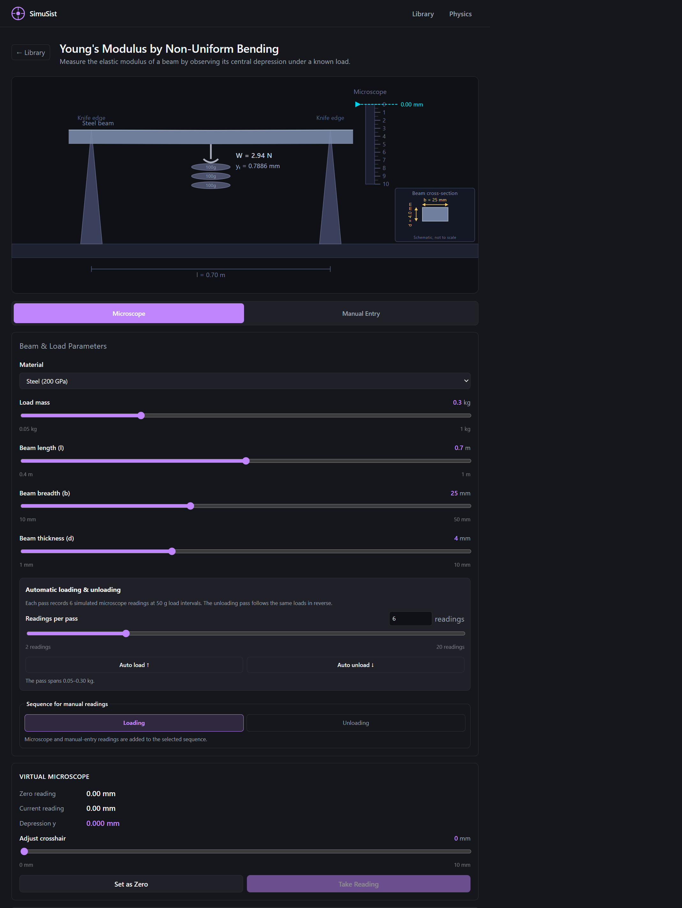
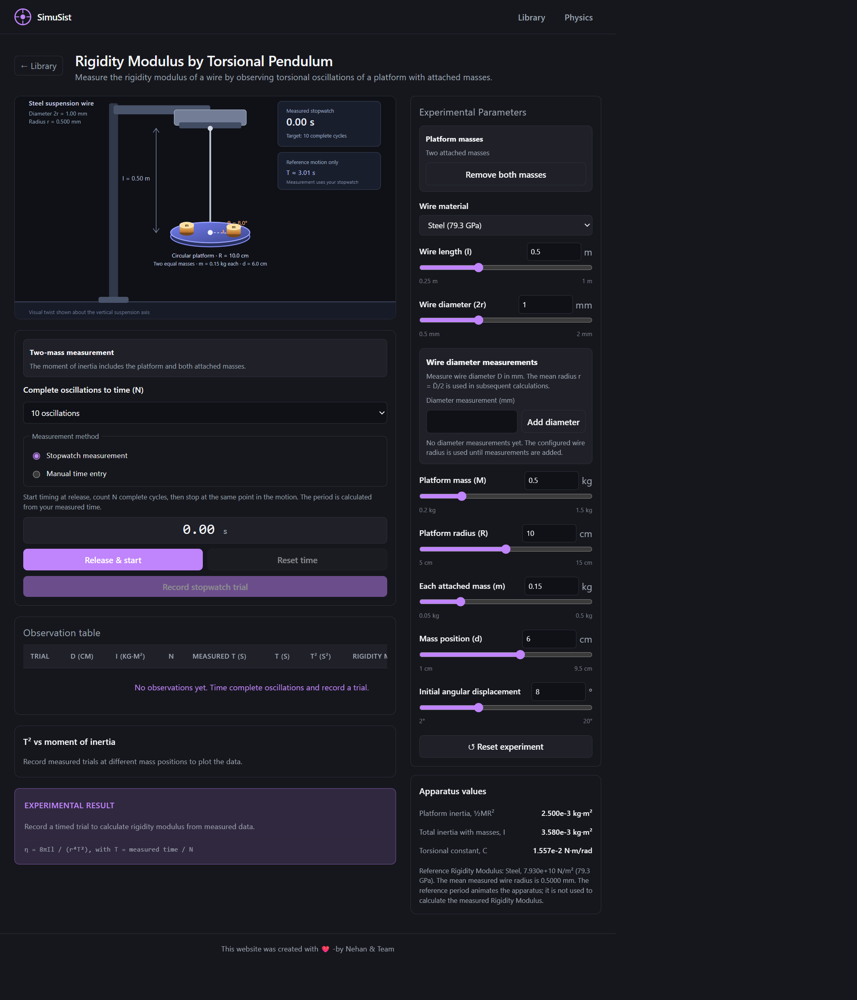
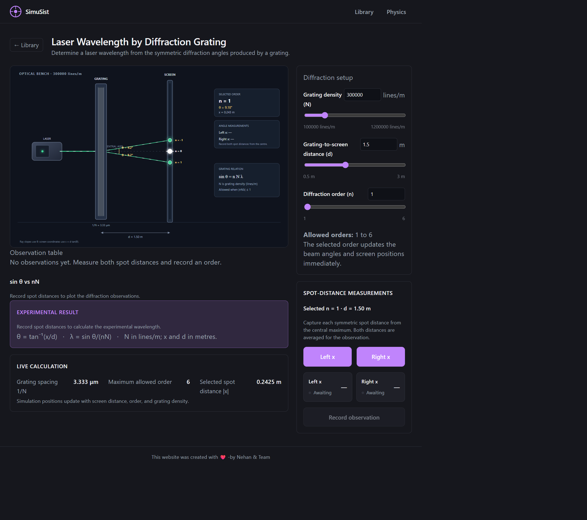
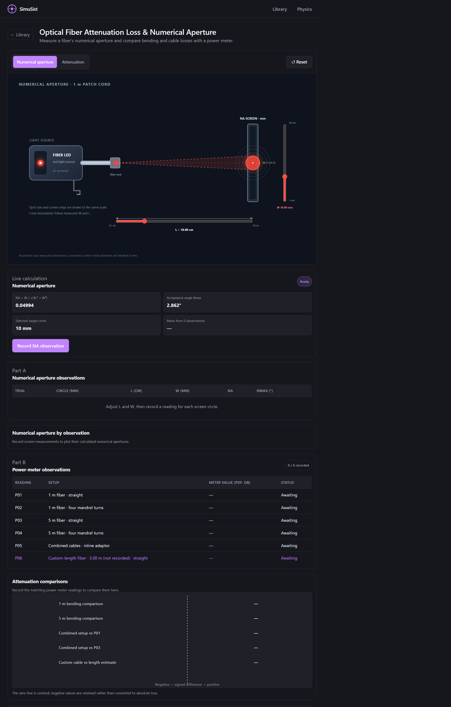
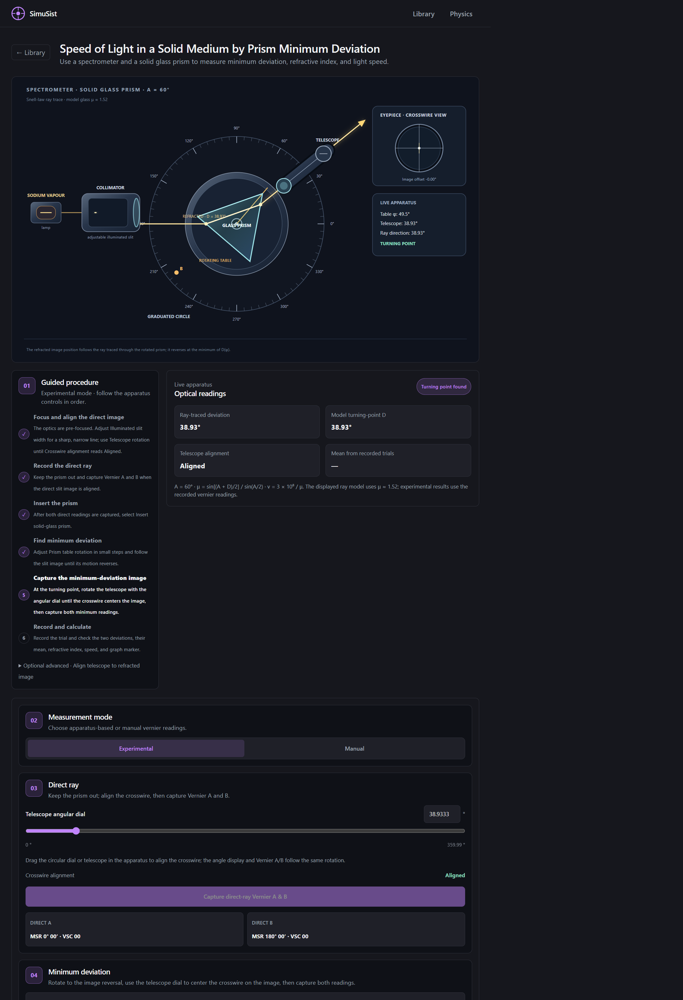
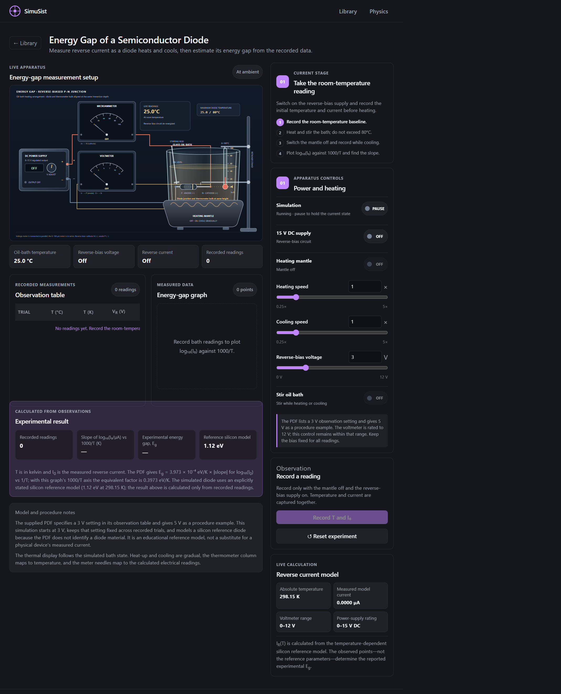

# SimuSist

## Project introduction

SimuSist is an interactive virtual physics laboratory for exploring experiments through simulated scientific apparatus. Students can manipulate experiment controls, take measurements, record observations, inspect graphs, and calculate results from their recorded data. It is an educational simulation, not a substitute for physical laboratory equipment.

## Completed experiments

1. **Young's Modulus by Non-Uniform Bending** — Explore beam bending under load, take microscope or manual readings, and calculate Young's modulus from the measured depression.
2. **Rigidity Modulus by Torsional Pendulum** — Measure oscillation time for a platform and attached masses, then calculate the wire's rigidity modulus and compare T² with moment of inertia.
3. **Laser Wavelength by Diffraction Grating** — Measure symmetric diffraction spots at adjustable screen distances and determine wavelength from diffraction order, angle, and grating line density.
4. **Optical Fiber — Numerical Aperture and Attenuation Loss** — Measure numerical aperture with the fiber apparatus and compare manually entered power-meter readings for different cable configurations.
5. **Prism Spectrometer — Measurement of Speed of Light in a Solid Medium by Minimum Deviation** — Use the spectrometer and glass-prism ray model to record direct and minimum-deviation Vernier readings, then calculate refractive index and light speed.
6. **Semiconductor Diode — Determination of Energy Gap** — Simulate heating and cooling a diode, record reverse-current measurements, and estimate its energy gap from the plotted data.

## Key features

- Interactive apparatus with experiment-specific controls and real-time measurements.
- Observation tables that retain recorded trials and readings.
- Graphs and calculated results based on experiment observations.
- Experimental and manual measurement workflows where supported.
- Animated apparatus and physics-driven optical ray behaviour where applicable.
- Responsive layouts for desktop and narrow screens.

## Technology stack

- React 19 and React DOM.
- TypeScript.
- Vite 8 with the React plugin.
- React Router 7 for application navigation.
- Oxlint for linting.
- npm for dependency installation and project scripts.

## Quality assurance and validation

The latest six-experiment QA audit covered all experiment routes and reported:

- All six experiment routes and their primary workflows were browser-tested.
- Independent representative scientific calculations, formulas, and unit conversions were checked.
- Confirmed issues were fixed and browser-retested: Young's Modulus reset defaults are restored correctly, and Prism Spectrometer dial values settle to the supported step and display with more precision.
- Desktop and narrow mobile layouts, including a 390 px viewport, were checked.
- Navigation, reset behaviour, and cross-experiment state isolation were checked.
- The production build passed.
- Lint passed with three pre-existing warnings.
- `git diff --check` passed.

## Known limitations

- Optical Fiber P01–P05 power-meter readings are entered manually. P06 is estimated from the selected cable length.
- Prism Vernier B uses the idealized `A + 180°` model rather than a separate physical Vernier reading.
- Minimum deviation is detected by proximity to the modeled turning point; it is not a hardware-level optical measurement.
- Physical handset testing and coverage in other browsers were not completed in the final audit.

## Screenshots

Desktop screenshots were captured from the running application at a 1440 × 1000 browser viewport. Select an image to open its full-size version.

| Experiment 01 — Young's Modulus | Experiment 02 — Torsional Pendulum |
| --- | --- |
| [](docs/screenshots/01-youngs-modulus.png) | [](docs/screenshots/02-torsional-pendulum.png) |
| **Experiment 03 — Diffraction Grating** | **Experiment 04 — Optical Fiber** |
| [](docs/screenshots/03-diffraction-grating.png) | [](docs/screenshots/04-optical-fiber.png) |
| **Experiment 05 — Prism Spectrometer** | **Experiment 06 — Semiconductor Diode** |
| [](docs/screenshots/05-prism-spectrometer.png) | [](docs/screenshots/06-semiconductor-diode.png) |

## Installation and running locally

Install a current Node.js release with npm, then run these commands from the project root in Windows PowerShell:

```powershell
npm.cmd install
npm.cmd run dev
```

Vite prints the local development URL after startup. Other available project commands are:

```powershell
npm.cmd run build
npm.cmd run lint
npm.cmd run preview
```

The production build is written to `dist/`.

## Deployment

The repository includes a `vercel.json` rewrite that sends application routes to `/index.html`, supporting client-side navigation and direct route refreshes on Vercel. This configuration does not establish a linked Vercel project or confirm deployment status. No deployment was performed for this release documentation task.
